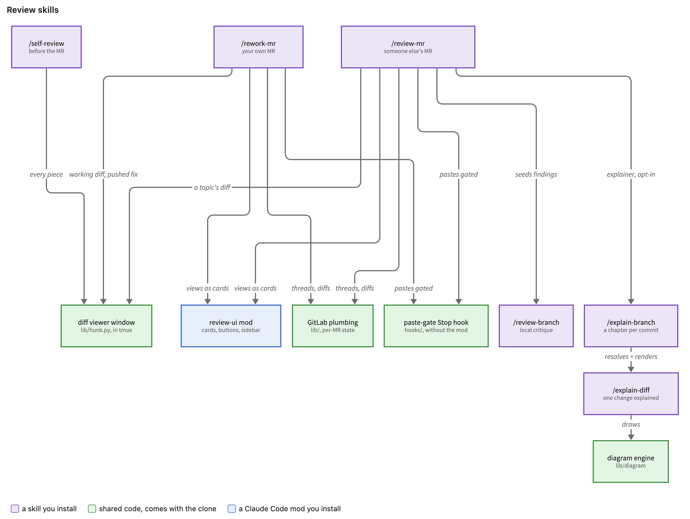

# agent-skills

Agent Skills for [Claude Code](https://docs.claude.com/en/docs/claude-code) and
[OpenCode](https://opencode.ai/), for **agentic code review** and for understanding unfamiliar
code. The agent does the reading, the digging and the drafting; every judgement stays yours.

The merge-request skills work against GitLab through the [`glab`](https://gitlab.com/gitlab-org/cli)
CLI. Nothing reaches GitLab unattended: posting a comment, pushing a fix and closing a thread
each wait for your press.

## Review 2.0

In Claude Code, `review-mr` and `rework-mr` come with the [review-ui mod](mods/review-ui/README.md),
which turns the chat into a review tool:

- **A card per topic.** Each topic of the review is a card in the chat: the agent's analysis,
  the plan, the fix or the drafted reply, with buttons for the decision on it. Most presses
  need no model turn: agreeing a plan, pushing a checked fix, posting a reply.
- **A sidebar beside the chat.** It shows the topics grouped by where they stand, the
  commented code with its thread under the lines it is on, and the fix's files with their
  sizes.
- **Rounds and an inbox.** What arrives while you wait (a reply, a push, a new thread) is
  marked in the sidebar and judged by a background agent, so the topic's card already carries
  the verdict when you get to it.
- **Fixes you can follow.** In `rework-mr` a fix is made, checked with the repository's own
  hooks and tests, folded into the commit it belongs to and force-pushed on one press. After
  the push, the card lists the steps the topic went through, and **Show fix in hunk** opens
  the fix in [Hunk](https://hunk.dev/), a terminal diff viewer, beside the chat.

## The skills

| skill | what it does |
|---|---|
| **explain-diff** | An interactive HTML page that teaches one change (background, a code walkthrough, diagrams and a quiz), for the current branch, a named branch, a GitLab MR or the last commit. |
| **explain-branch** | The same for a whole branch or MR, one chapter per substantial commit: how the feature was built, step by step. |
| **visualize** | One diagram that answers one question about the code (a database layout, a flow, a state machine, an architecture), drawn with [D2](https://d2lang.com) and checked in a real browser for legibility, clipping and WCAG AA contrast. |
| **review-branch** | A critique of the current branch's commits: a prioritized list of concrete flaws with fix hints. Local only. |
| **review-mr** | A review of a GitLab MR **someone else wrote**: an optional explainer, findings seeded by `review-branch`, then one topic at a time to a drafted comment you post. A re-review loop follows replies and pushes over days and closes nothing without your ack. |
| **rework-mr** | The feedback on an MR **you wrote**: one topic at a time to a plan, a fix folded into the commit it belongs to and force-pushed, and the thread's reply in the thread's own language. |
| **self-review** | Your own review of your change in Hunk before an MR exists, commit by commit: you leave notes on its lines, the agent answers them and amends what you agree to. |
| **split-handoff** | A side task that turns up mid-session, moved into its own worktree, branch and agent session in a new tmux window, with a handoff to start from. |

`review-mr` and `rework-mr` are resumable: run them again in a new session, on a new day, and
they pick the MR up where it stood.

## Usage

Invoke a skill by name, or just ask for what it does:

```
/visualize what happens when a user logs in
/explain-diff mr:123          # also: branch:feat/x, commit:abc1234, or nothing for the current branch
/explain-branch mr:123
/review-branch
/review-mr !123
/rework-mr
/self-review
/split-handoff the rounding bug in the totals
```

## How they fit together

<picture>
  <source media="(prefers-color-scheme: dark)" srcset="docs/review-skills-dark.png">
  
</picture>

Drawn by `visualize` itself, from [`docs/review-skills.json`](docs/review-skills.json).

- `explain-branch` needs `explain-diff`; `review-mr` needs `explain-branch` and
  `review-branch`. The others stand alone.
- Shared code (the diagram engine, the GitLab plumbing, the diff viewer window) lives in `lib/`,
  inside the clone every link points at, so it needs no install of its own.

## Installation

Link the skills into the skill directory both Claude Code and OpenCode read, and keep the
clone where you put it: the links point back into it.

```bash
git clone git@github.com:yogan/agent-skills.git ~/src/agent-skills
for s in ~/src/agent-skills/skills/*/; do
  ln -sfn "${s%/}" ~/.claude/skills/"$(basename "$s")"
done
```

Then start a new session. On Claude Code, for `review-mr` and `rework-mr`:

- **The review-ui mod** (recommended), from the clone:

  ```bash
  claude plugin marketplace add ~/src/agent-skills
  claude plugin install review-ui@yogan-agent-skills
  ```

- **Without the mod, a `Stop` hook** that makes the model paste the skills' views instead of
  paraphrasing them. It is one symlink and one settings entry: [`hooks/README.md`](hooks/README.md).
  Where the mod is loaded, the hook stands down by itself.
- **Three read permissions**, so the skills' own files and per-MR state raise no prompts. Add
  them to `~/.claude/settings.json`:

  ```json
  { "permissions": { "allow": [
    "Read(~/.claude/skills/**)", "Read(~/.claude/rework-mr/**)", "Read(~/.claude/review-mr/**)"
  ] } }
  ```

## Requirements

| you need | for |
|---|---|
| `python3` | nearly everything |
| [`glab`](https://gitlab.com/gitlab-org/cli), authenticated | `review-mr`, `rework-mr`, and `mr:` targets of the explainers |
| [D2](https://d2lang.com) (`brew install d2`) | every diagram; the engine says when the installed release differs from the one it was measured against |
| `node` and `puppeteer-core` (`npm i -g puppeteer-core`) | checking a diagram in your installed Chrome, Chromium or Edge |
| `tmux` | `split-handoff`'s new window, and the diff viewer below. Nothing else needs it: the review skills and the mod run without it |
| [`hunk`](https://hunk.dev/) inside `tmux` | `self-review`; optional for `review-mr` and `rework-mr`, to show a diff beside the chat |

## Under the hood

| path | what it is |
|---|---|
| `skills/<name>/` | one skill each: `SKILL.md`, and its Python in `scripts/` |
| `mods/review-ui/` | the Claude Code mod behind Review 2.0: [`mods/review-ui/README.md`](mods/review-ui/README.md) |
| `lib/` | Python shared repo-wide; the diagram engine in [`lib/diagram/`](lib/diagram/README.md) |
| `hooks/` | the `Stop` hook for sessions without the mod |
| `e2e/` | a local GitLab rig that drives real sessions through the review skills: [`e2e/README.md`](e2e/README.md) |

Tests are plain `unittest`: `python3 run_tests.py` runs the fast suite, `--changed` only what
your edits can reach. The working rules for changing anything are in [CLAUDE.md](CLAUDE.md).

## License

MIT, see [LICENSE](LICENSE).
